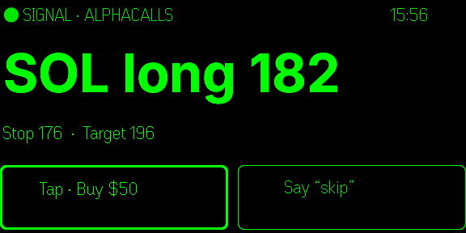
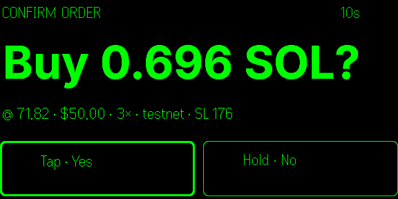
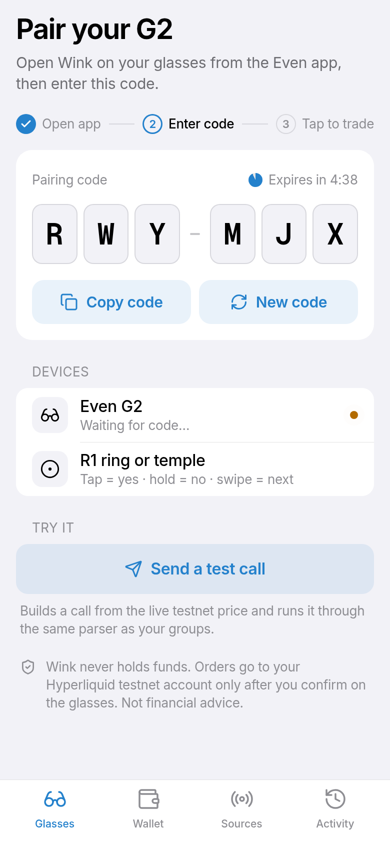
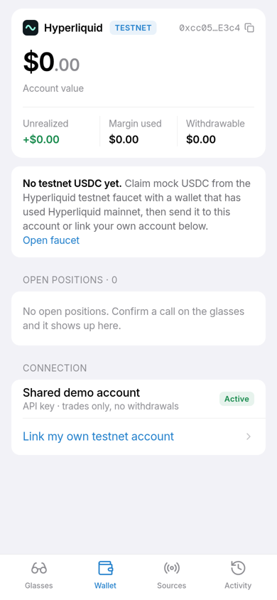
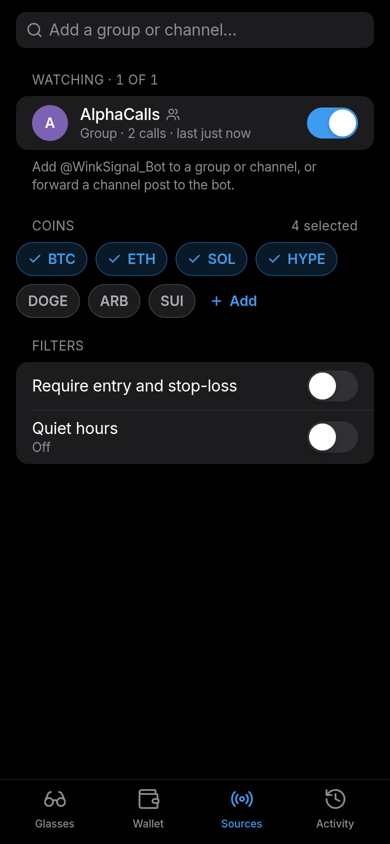
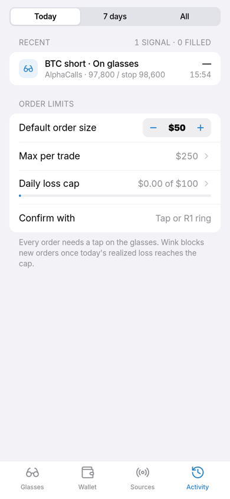

# Wink

Trade calls from your Telegram groups, on your Even G2 glasses. Tap to buy, hold to pass, say "skip". Orders go to **Hyperliquid testnet** through a trade-only API wallet that can't withdraw.

<p>


</p>
<p>




</p>

- **Live:** https://wink-ijustabi.vercel.app
- **Telegram:** [@WinkSignal_Bot](https://t.me/WinkSignal_Bot) and its menu button opens the Mini App
- **Glasses app:** `release/wink.ehpk` (Even Hub package, `com.mozoraid.wink`)

> Testnet only. Wink never holds funds and is not financial advice.

## How it works

1. Add **@WinkSignal_Bot** to a Telegram group or channel you follow (as admin, so it can read posts), or forward a post from a channel to the bot.
2. Wink reads each message and pulls out the call: coin, side, entry (or range), stop, target, leverage. Rule-based parser first; an LLM fallback handles messy wording.
3. The call shows up on your G2 within a few seconds:
   - **Signal card**: `ETH long 3,400 · Stop 3,320 · Target 3,560`. Tap = buy the default size ($50). Hold or say "skip" = pass.
   - **Confirm card**: `Buy 0.015 ETH? @ 3,400 · $50 · 3× · SL 3,320`. Tap = yes, hold = no, auto-cancels after 10 s.
   - **Position card**: live PnL and ROE; swipe through open positions. Tap, then say "close half" or "close".
4. Confirmed orders go to Hyperliquid testnet as IOC orders (±1% from mid) with the call's stop-loss and take-profit attached as trigger orders.

### Guardrails

| Limit | Default |
| --- | --- |
| Order size | $50 |
| Max per trade | $250 |
| Daily loss cap | $100 (realized, from today's fills; new orders are blocked once hit) |
| Leverage | the call's leverage, capped at 5× (3× if none given) |
| Confirm | every order needs a tap on the glasses; voice "buy" still opens the confirm card |

Stops and targets are only attached when they sit on the correct side of the current price.

## Architecture

```
Telegram group/channel ──▶ @WinkSignal_Bot ──webhook──▶ /api/telegram/webhook
                                                          │ parse (rules → LLM fallback)
                                                          ▼
                                                   Vercel Blob (KV)
                                         users · sources · feeds · devices
                                                          ▲
 Telegram Mini App  ── /api/me/* (initData auth) ─────────┤
 (pairing, wallet, sources, limits)                       │
                                                          │
 Even G2 app (Even Hub WebView) ── /api/glasses/* (device token)
   poll state · act · close · voice (PCM → STT → intent)  │
                                                          ▼
                                             Hyperliquid testnet
                                     (info + exchange via agent wallet)
```

| Part | Where | Notes |
| --- | --- | --- |
| Backend + Mini App | `app/`, `lib/` | Next.js 16 on Vercel (Node 24). Storage is a private Vercel Blob store used as a small KV with ETag-guarded writes. |
| Glasses app | `g2/` | Vite + `@evenrealities/even_hub_sdk`. 576×288 mono display: text containers for small lines, the headline drawn on a canvas and pushed as two 288×104 image tiles (the firmware has one font size). |
| Telegram auth | `lib/telegram.ts` | Mini App `initData` checked with the bot token (HMAC) or Telegram's Ed25519 third-party signature. |
| Pairing | `lib/db.ts` | 6-character code (no 0/O/1/I/L), 5-minute expiry, typed into the Even app on the phone. The glasses get a device token; no Google sign-in, no API keys on the glasses. |
| Trading | `lib/hl.ts`, `lib/trade.ts` | `@nktkas/hyperliquid`, testnet transport only. Users can link their own testnet API wallet; the key is checked against `extraAgents` and stored AES-GCM encrypted. |
| Voice | `g2/src/voice.ts`, `lib/ai.ts` | On-glasses energy VAD → 16 kHz PCM → `/api/glasses/voice` → speech-to-text (ElevenLabs Scribe if `ELEVENLABS_API_KEY` is set, otherwise Vercel AI Gateway) → intent (`buy`, `sell`, `skip`, `close`, `close half`, English and Indonesian). |

### API

| Route | Auth | Purpose |
| --- | --- | --- |
| `POST /api/telegram/webhook` | `X-Telegram-Bot-Api-Secret-Token` | Bot updates (`/start`, `/watch`, group posts, forwards, bot added/removed) |
| `GET /api/me` | `Authorization: tma <initData>` | Mini App state |
| `POST /api/me/pair`, `/unpair`, `/settings`, `/sources`, `/wallet`, `/close`, `/test-signal` | same | Mini App actions |
| `POST /api/glasses/pair` | pairing code | Exchange code for a device token |
| `GET /api/glasses/state` | `Bearer <device token>` | Pending call, live price, positions, limits |
| `POST /api/glasses/act`, `/close`, `/voice` | same | Buy/sell/skip, close, voice command |
| `GET /api/health` | none | Config and Hyperliquid reachability |

## Setup

Requirements: Node 24, a Telegram bot from @BotFather, a Vercel project with a Blob store.

```bash
npm install
cd g2 && npm install && cd ..
npm test           # parser + intent tests
npm run build      # builds the glasses app into public/g2, then Next.js
```

### Environment variables

| Name | Required | What |
| --- | --- | --- |
| `TELEGRAM_BOT_TOKEN` | yes | From @BotFather. Needed for replies, chat info and HMAC initData checks. |
| `TELEGRAM_BOT_ID` | yes | Numeric bot id (for Ed25519 initData checks) |
| `TELEGRAM_WEBHOOK_SECRET` | yes | Random string, also passed to `setWebhook` as `secret_token` |
| `WINK_SECRET` | yes | 32+ random bytes, encrypts linked API wallet keys |
| `BLOB_READ_WRITE_TOKEN` | yes | Added by Vercel when a Blob store is connected. Without it, data lives in memory (local dev). |
| `HL_MASTER_ADDRESS`, `HL_AGENT_PRIVATE_KEY` | for the shared demo account | Testnet account and its approved API wallet |
| `WINK_ADMIN_TOKEN` | optional | Enables `/api/admin/status` and Mini App preview links |
| `ELEVENLABS_API_KEY` | optional | Speech-to-text via Scribe; otherwise Vercel AI Gateway (OIDC on Vercel) |

### Telegram

```bash
curl "https://api.telegram.org/bot$TELEGRAM_BOT_TOKEN/setWebhook" \
  -d url=https://<your-domain>/api/telegram/webhook \
  -d secret_token=$TELEGRAM_WEBHOOK_SECRET \
  -d 'allowed_updates=["message","channel_post","my_chat_member"]'

curl "https://api.telegram.org/bot$TELEGRAM_BOT_TOKEN/setChatMenuButton" \
  -H 'content-type: application/json' \
  -d '{"menu_button":{"type":"web_app","text":"Wink","web_app":{"url":"https://<your-domain>/app"}}}'
```

The bot runs with privacy mode on, so it only sees group posts when it's an admin. Turn privacy off in @BotFather if you'd rather add it as a regular member.

### Hyperliquid testnet

1. Create a testnet account at https://app.hyperliquid-testnet.xyz and get mock USDC from the faucet. The faucet only pays out to addresses that have used Hyperliquid mainnet.
2. Under **API**, create an API wallet. It can trade but can't withdraw.
3. In the Mini App, go to **Wallet → Link my own testnet account** and paste the account address and the API wallet key. Or set `HL_MASTER_ADDRESS` and `HL_AGENT_PRIVATE_KEY` for the shared demo account.

### Glasses app

```bash
cd g2
npm run dev                                   # Vite on :5173
npx evenhub-simulator http://localhost:5173   # G2 simulator
VITE_WINK_API=https://<your-domain> npm run pack   # → release/wink.ehpk
```

`app.json` whitelists the backend origin; update it if you deploy elsewhere. The deployed backend also serves the glasses app at `/g2/index.html`.

## Demo

1. Open [@WinkSignal_Bot](https://t.me/WinkSignal_Bot) → **Start** → **Open Wink**.
2. **Glasses** tab → note the 6-character code.
3. On the phone, open Wink in the Even app (or the simulator) and type the code. The glasses show **No new calls**.
4. Add the bot as admin to a group and post `ETH long 3,400 / stop 3,320 / target 3,560`. Or tap **Send a test call** in the Mini App.
5. The signal card appears on the glasses. Tap → confirm card with size and stop → tap → order on Hyperliquid testnet.
6. Swipe to see the position and live PnL. Tap, say "close half".
7. **Activity** shows the call, the fill and how much of the daily loss cap is used.

## What existed before Nov 23, 2026

Only design mockups, made on Nov 22, 2026: static HTML/PNG screens for the four Mini App tabs and three glasses cards. There was no code. The backend, Telegram bot, Mini App, glasses app, parser, Hyperliquid integration and packaging in this repo were all written on Nov 23, 2026.

## Feature requests

Things that would make Wink better and that we couldn't do from the app side:

1. **Even Hub: more text sizes or a font API.** The firmware has one text size, so Wink draws headlines on a canvas and sends them as image tiles. A built-in large font would be sharper and cheaper over Bluetooth.
2. **Even Hub: notification access for apps.** Showing a call as a system notification, even while another app is open, would beat polling inside a foreground app.
3. **Telegram: read-only channel access for bots without admin rights.** Today a bot only sees channel posts if it's an admin, which most signal channels won't allow, so users have to forward posts.
4. **Hyperliquid: testnet faucet without a mainnet deposit.** New users can't get mock USDC unless the same address has used mainnet, which blocks first-time demos.
5. **Even Hub simulator: audio file injection.** Feeding a WAV into the simulator mic would make voice commands testable in CI.

## Project layout

```
app/            Next.js routes: landing, Mini App (/app), API (/api/*)
lib/            parser, intents, storage, Telegram, Hyperliquid, trading rules
g2/             Even G2 app (Vite), app.json, phone companion UI
release/        packaged .ehpk
docs/           screenshots
```
